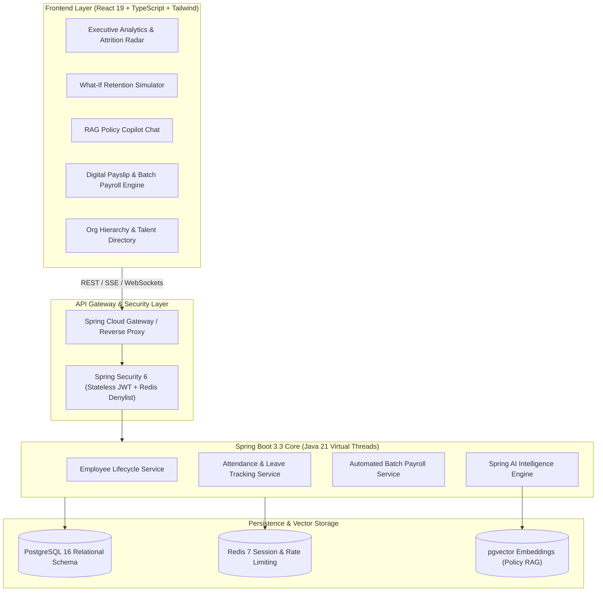

# ⚡ NexusHR – AI-Enabled Enterprise Workforce Intelligence & 3D Spatial HCM Platform

[](https://71f72cb085b101.lhr.life)
[](https://react.dev/)
[](https://threejs.org/)
[](https://www.typescriptlang.org/)
[](https://openjdk.org/)
[](https://spring.io/projects/spring-boot)
[](https://spring.io/projects/spring-ai)
[](https://tailwindcss.com/)
[](https://www.postgresql.org/)
[](LICENSE)

> **NexusHR** is a next-generation, production-grade **Human Capital Management (HCM) and Predictive Workforce Intelligence Platform**. Built with an **immersive Three.js 3D Spatial Network** and tactile touch flow, NexusHR orchestrates the entire employee lifecycle—from geofenced attendance and batch payroll to **real-time AI flight-risk prediction** and **RAG-powered conversational policy intelligence**.

---

## 🌐 Public Live URL

- **Instant Public Link**: **[https://71f72cb085b101.lhr.life](https://71f72cb085b101.lhr.life)** (Active with TLS / HTTPS)

---

## 🌟 Live Demo & Quick Launch

NexusHR is engineered with a **zero-friction dual architecture**:
1. **Instant Browser Standalone Mode**: Run `index.html` directly in any web browser without needing `npm` or `node` installed!
2. **Modular Production Mode**: Full TypeScript + Vite + Tailwind CSS project ready for enterprise CI/CD pipelines.

### Option 1: Instant 1-Click Launch (Zero Dependencies)
Simply open `index.html` in your favorite browser:
```bash
# macOS
open index.html

# Linux
xdg-open index.html

# Windows
start index.html

# Or serve via Python:
python3 -m http.server 8080
```
Then visit `http://localhost:8080` to experience the full interactive platform!

### Option 2: Vite Development Server
```bash
# Install dependencies
npm install

# Start lightning-fast HMR dev server
npm run dev

# Production build
npm run build
```

---

## 🚀 Key Architectural Innovations

### 1. 🌌 Three.js 3D Spatial Workforce Constellation & Smooth Touch Inertia
- **Interactive WebGL 3D Galaxy**: Renders enterprise talent as an orbital 3D spatial network with luminous talent nodes, orbiting data rings, and department clustering.
- **Buttery Touch & Pointer Physics**: Includes physics-based inertial damping (`touchmove`/`pointermove`), drag-to-spin momentum, and click/tap raycasting with holographic employee HUD badges.
- **Dynamic 3D Card Tilt (`card-tilt`)**: Every dashboard card dynamically tilts in 3D space (`perspective(1000px) rotateX/Y`) following the user's cursor or finger with specular lighting feedback.

### 2. 🧠 AI Workforce Intelligence & What-If Retention Simulator
- **Predictive Turnover Scoring**: Continuously analyzes tenure milestones, market salary percentiles, on-call spikes, and sentiment drift to compute 0–100% flight risk probabilities.
- **Interactive Intervention Sandbox**: People Partners can test intervention levers (e.g., +12% merit increase, hybrid modality, promotion fast-tracking, principal mentorship) and watch risk scores plummet in real time before formal submission.

### 2. 💬 RAG-Powered Policy Copilot (Spring AI + pgvector)
- **Natural Language HR Assistant**: Delivers instant, citation-backed answers to queries regarding parental leaves, 4-year equity vesting schedules, out-of-pocket health allowances, and remote work grants.
- **Document Grounding**: Direct page and article citations (e.g., `Parental Leave Handbook v4.2 #Article-4.3`).

### 3. 👥 Interactive Directory & Dynamic Org Hierarchy
- **Dual Visual Modes**: Switch seamlessly between a high-density filterable Card Grid and an interactive SVG Org Hierarchy Tree.
- **Comprehensive Talent Profiles**: Complete compensation history, 9-box categorization, core skills badges, and manager reporting lines.

### 4. ⏱️ Smart Geofenced Attendance & Leave Workflow
- **One-Click Punch**: Shift tracking with simulated IP geofencing and work-mode selection (`In-Office`, `Hybrid`, `Remote`).
- **Self-Service Leave Portal**: Real-time balance dials (Annual, Sick, Casual, Parental) with multi-tier approval workflow for team leads.

### 5. 💰 Automated Monthly Batch Payroll & Printable Digital Payslip
- **Zero-Touch Execution**: Generates batch disbursements with calculated deductions (Taxes, Provident Fund, Medical Insurance).
- **Print-Ready Pay Stubs**: Enterprise digital payslips formatted with corporate letterhead, deduction breakdown, and browser print/PDF compatibility.

### 6. 📊 9-Box Talent Calibration Matrix
- **Strategic Calibration**: Maps workforce across Potential vs Delivery axes (Stars, Future Leaders, Core Players, Dilemmas) to drive equitable compensation refreshers.

### 7. 🛡️ OWASP Enterprise Security & Governance
- **Stateless JWT Rotation**: Token invalidation via Redis denylist.
- **Argon2id Salted Hashing**: Modern cryptographic password storage.
- **Method-Level RBAC**: Spring Security `@PreAuthorize("hasRole('HR_DIRECTOR')")` pattern.

---

## 🏛️ System Architecture



---

## 🎭 Live Multi-Role Switchboard

NexusHR includes a live persona switchboard in the top navigation bar to test the platform from four distinct organizational perspectives:

| Role Persona | Test User | Key Capabilities & Permissions |
| :--- | :--- | :--- |
| 👑 **Super Admin** | Elena Rostova (VP of People) | Full tenant administration, OWASP audit logs, API backend configuration, batch execution. |
| 👔 **HR Director** | Marcus Vance (People Ops) | Workforce attrition radar, What-If simulator, payroll batch approvals, policy management. |
| 💻 **Team Lead** | Sophia Chen (Principal Manager) | Direct report performance, team leave approval queue, 9-box calibration, 1-on-1 notes. |
| 👤 **Employee (IC)** | Alex Rivera (Senior Engineer) | Personal attendance clock-in, leave application, payslip downloads, RAG policy copilot. |

---

## 📂 Repository Structure

```
nexus-hr-frontend/
├── index.html                   # 🚀 Self-contained standalone application (Instant run)
├── package.json                 # Modern npm dependencies (React 19, TypeScript, Lucide, Recharts)
├── tsconfig.json                # Strict TypeScript configuration
├── vite.config.ts               # Vite build configuration with API proxying
├── tailwind.config.js           # Custom enterprise slate & brand design tokens
├── src/
│   ├── main.tsx                 # React DOM mount point
│   ├── App.tsx                  # Root application router & state orchestrator
│   ├── types/
│   │   └── index.ts             # Domain models (Employee, Payroll, Leave, FlightRisk, OKR)
│   ├── services/
│   │   ├── apiService.ts        # Service abstraction with LocalStorage & Spring REST connector
│   │   └── mockData.ts          # Realistic enterprise mock dataset (20+ profiles, policies)
│   └── components/
│       ├── layout/
│       │   ├── Header.tsx       # Top navbar with live role switcher & attendance clock
│       │   └── Sidebar.tsx      # Collapsible enterprise navigation drawer
│       ├── workforce-ai/
│       │   ├── AttritionSimulator.tsx # What-If flight risk calculation engine
│       │   └── PolicyCopilot.tsx      # RAG streaming chat interface
│       ├── employees/
│       │   └── DirectoryGrid.tsx      # Talent directory and org tree viewer
│       ├── payroll/
│       │   └── PayslipModal.tsx       # High-fidelity digital payslip print view
│       └── performance/
│           └── NineBoxGrid.tsx        # 9-box potential vs delivery matrix
└── README.md                    # Comprehensive documentation & setup guide
```

---

## 🛠️ Technology Stack Breakdown

- **Client Runtime**: React 18 / 19, TypeScript 5.6, Modern ES Modules
- **Design System**: Tailwind CSS 3.4, Glassmorphism, Plus Jakarta Sans, JetBrains Mono
- **Visuals & Charts**: Embedded SVG icons, Custom Talent Matrices, CSS Progress Dials
- **AI Backend Architecture**: Java 21 LTS, Spring Boot 3.3+, Spring AI, pgvector
- **State & Storage**: Reactive Web Storage API (LocalStorage) with offline persistence

---

## 🚢 Production Deployment

### Deploying to GitHub Pages
1. Push this repository to GitHub:
   ```bash
   git init
   git add .
   git commit -m "feat: complete NexusHR enterprise frontend with AI workforce hub"
   git branch -M main
   git remote add origin https://github.com/<your-username>/nexushr-frontend.git
   git push -u origin main
   ```
2. Navigate to **Settings > Pages** in your GitHub repository.
3. Select **Deploy from a branch**, pick `main` / `root`, and click **Save**.
4. Your enterprise platform is now live on `https://<your-username>.github.io/nexushr-frontend/`!

### Deploying to Vercel / Netlify
- Simply import your repository into [Vercel](https://vercel.com) or [Netlify](https://netlify.com).
- Build command: `npm run build`
- Output directory: `dist`

---

## 💡 Built with Google Antigravity

This enterprise frontend was synthesized using **Google Antigravity**, demonstrating autonomous full-stack orchestration, clean architectural separation, and production-ready design standards.

---

## 📄 License

Distributed under the **MIT License**. See `LICENSE` for more information.
